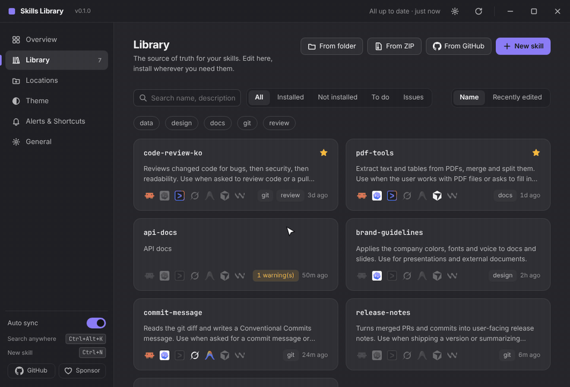
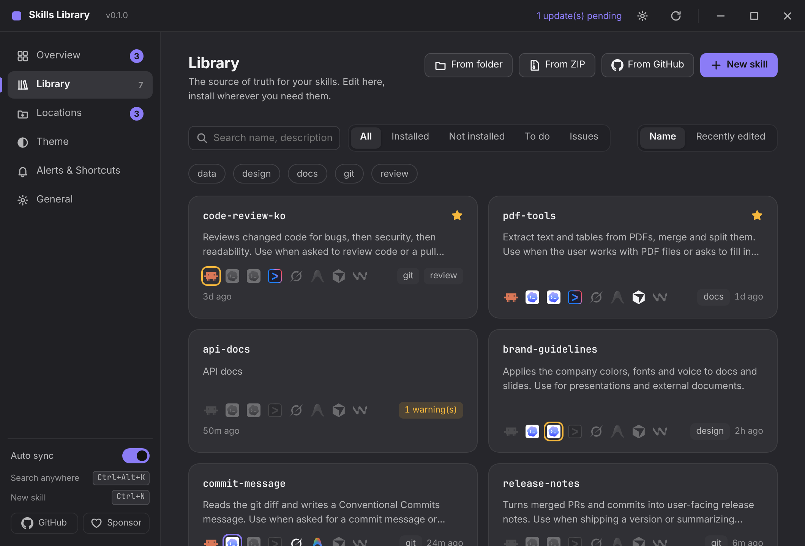
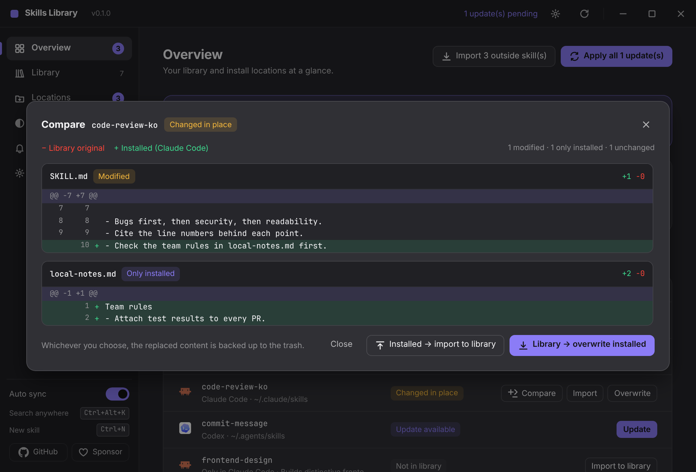
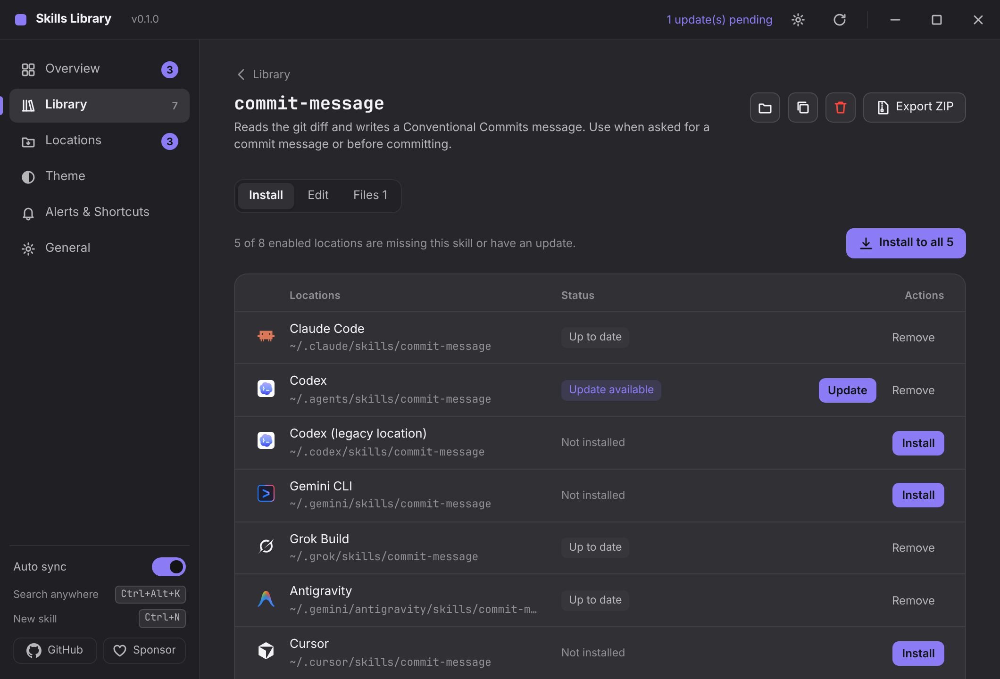
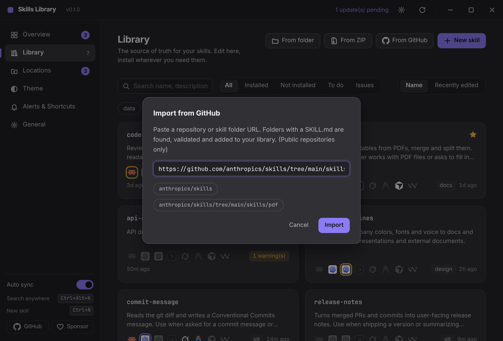

# Skills Library

[English](README.md) | [한국어](README.ko.md) | **日本語** | [简体中文](README.zh-CN.md)

Claude・Claude Code・Codex・Gemini CLI・Grok Build・Antigravity・Cursor・Windsurf の**エージェントスキルを一か所で管理するデスクトップアプリ**です。
スキルの原本をライブラリに置き、必要な場所へインストールし、編集するとインストール先にもすぐ反映されます。



## ダウンロード

**[⬇ 最新版をダウンロード（Windows インストーラー）](https://github.com/cheapbutsimilar/skills-Library/releases/latest)**

リリースの Assets から `…_x64-setup.exe` をダウンロードして実行してください。インストール後はアプリが自動で更新されます。

> **Windows SmartScreen の警告について** — インストーラーにはまだ有償のコード署名証明書がないため、初回実行時に
> 「Windows によって PC が保護されました」と表示されることがあります。**詳細情報 → 実行** をクリックしてください。
> インストーラーはこのリポジトリの公開 [リリースワークフロー](.github/workflows/release.yml) でビルドされ、GitHub Releases から配布されます。
> 自動更新はすべてアプリの更新署名で検証されます。

## 機能

- **ライブラリ** — スキル（`SKILL.md` を含むフォルダー）を集め、検索・タグ・お気に入りで整理します。
- **どこへでもインストール** — Claude Code、Codex、Gemini CLI、Grok Build、Antigravity、Cursor、Windsurf、プロジェクトフォルダーに
  インストール・更新・削除できます。1 か所ずつでも、**有効なエージェントすべてにワンクリック**でも可能です。
- **同期** — インストール時に内容のハッシュを記録し、ライブラリとインストール先のどちらが変更されたかを判別します。
  自動同期（既定でオン）では、ライブラリでの編集がすべてのコピーにすぐ反映されます。インストール先で直接編集されたものには触れません。
- **選ぶ前に差分を確認** — インストール先が「変更あり」「両方変更」の状態なら **比較** を開き、ライブラリの原本とインストール先の差分を
  ファイル・行単位で確認して、同じ画面から取り込み／上書きを選べます。
- **GitHub から取り込み** — リポジトリやフォルダーの URL（`https://github.com/owner/repo`、`…/tree/branch/path`）を貼り付けると、
  `SKILL.md` を含むフォルダーをダウンロードして検証し、ライブラリに追加します。フォルダー・ZIP・`.skill` ファイル、ドラッグ＆ドロップにも対応。
- **編集** — フォーム（name・description・本文）または `SKILL.md` の原文で編集でき、スクリプトや参考資料も編集できます。
  ルール（64 文字の小文字・ハイフン名、1024 文字の説明、XML タグ禁止など）は入力中にリアルタイムで検査されます。
- **Claude アプリ** — claude.ai と Claude デスクトップにはスキルフォルダーがないため ZIP でアップロードします。ワンクリックで ZIP を作成し、
  ライブラリが変わると再アップロードを促します。
- **整理** — 同じ名前で内容が異なるスキルは残すバージョンを 1 つ選んで全体を揃え、旧 Codex の場所（`~/.codex/skills`）のスキルは
  現在の場所（`~/.agents/skills`）へ移動します。内容を混ぜることはなく、置き換えられた版はゴミ箱にバックアップされます。
- **安全** — 削除・上書きしたものはすべてゴミ箱フォルダーへ移動するので、元に戻せます。
- **どこからでも検索** — <kbd>Ctrl+Alt+K</kbd> でウィンドウを開いてすぐ検索。トレイに常駐し、新しいスキルを通知します。
- **英語・韓国語 UI** — OS の言語に従い、**General › Language** で切り替えられます。

| ライブラリ | 差分比較 |
|---|---|
|  |  |
| **全エージェントにインストール** | **GitHub から取り込み** |
|  |  |

## インストール先

| エージェント | ユーザー全体 | プロジェクト |
|---|---|---|
| Claude Code | `~/.claude/skills` | `<project>/.claude/skills` |
| Codex | `~/.agents/skills` | `<project>/.agents/skills` |
| Codex（旧） | `$CODEX_HOME/skills`（既定 `~/.codex/skills`） | |
| Gemini CLI | `~/.gemini/skills` | `<project>/.gemini/skills` |
| Grok Build | `~/.grok/skills` | `<project>/.grok/skills` |
| Antigravity | `~/.gemini/antigravity/skills` | `<project>/.agent/skills` |
| Cursor | `~/.cursor/skills` | `<project>/.cursor/skills` |
| Windsurf | `~/.codeium/windsurf/skills` | `<project>/.windsurf/skills` |
| Claude アプリ | ZIP アップロード（設定 › 機能 › スキル） | |

各エージェントの設定フォルダーが見つかると、初回起動時に自動で有効になります。パスが異なる場合は アプリの **Locations › Change path** で合わせてください。

## 開発

必要なもの：Rust（stable）、Node 22、Linux の場合は Tauri のシステムライブラリ
（`libwebkit2gtk-4.1-dev libgtk-3-dev libayatana-appindicator3-dev librsvg2-dev libxdo-dev`）。

```bash
npm install
```

```bash
npm run preview        # モックデータのブラウザープレビュー → http://127.0.0.1:5199
```

```bash
npm run dev            # 実際のアプリ
```

```bash
npm test               # cargo test --workspace
```

```bash
npm run lint           # clippy + UI チェック
```

詳しい構成やリリース手順は [英語版 README](README.md) と [docs/RELEASE.md](docs/RELEASE.md) を参照してください。

## ライセンス

MIT

エージェントのロゴは [LobeHub Icons](https://github.com/lobehub/lobe-icons)（MIT）のものです。商標は Anthropic、OpenAI、Google、xAI、Anysphere、Cognition に帰属し、どのエージェントかを示す目的でのみ使用しています。

## 姉妹プロジェクト

**[Agent-Meter](https://github.com/cheapbutsimilar/Agent-Meter)** — AI コーディングエージェントの使用量と残量を表示するデスクトップウィジェットです。
