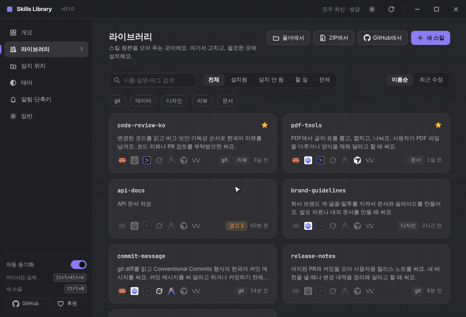
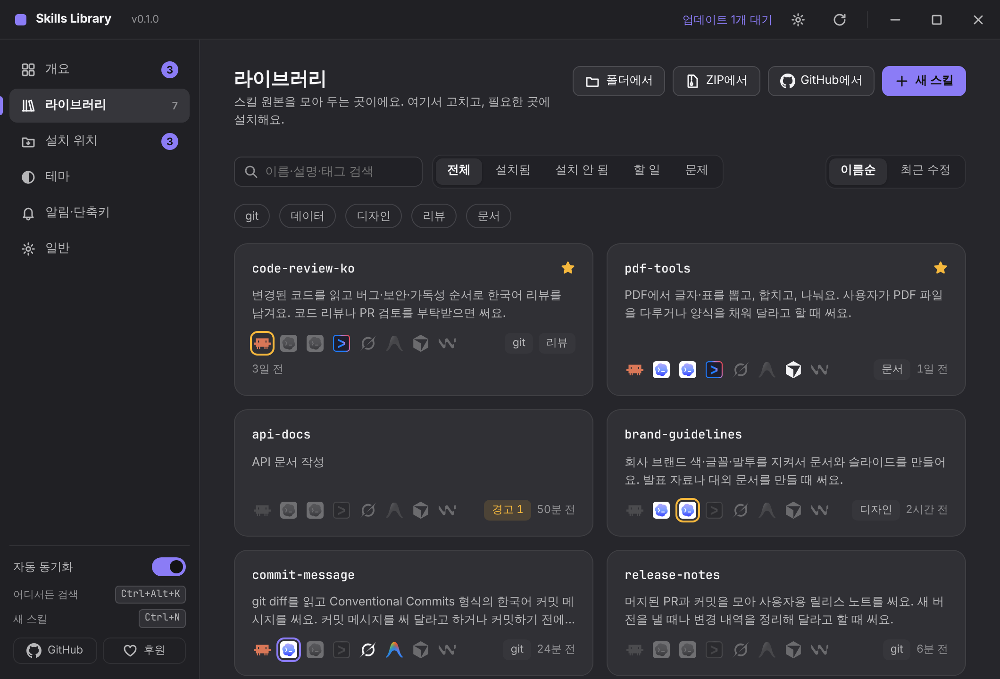
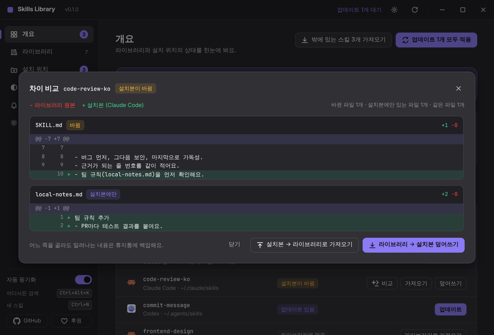
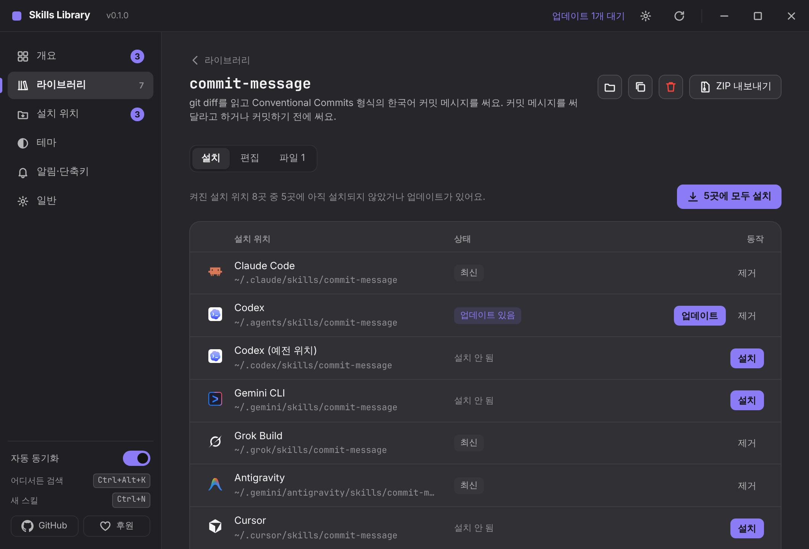
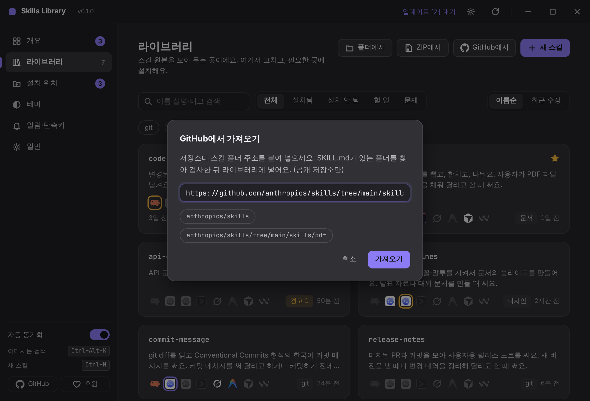
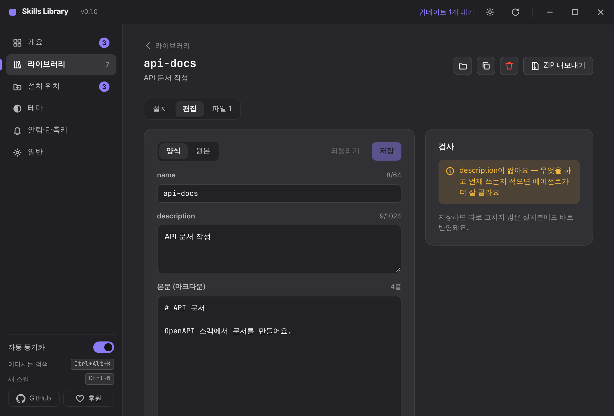
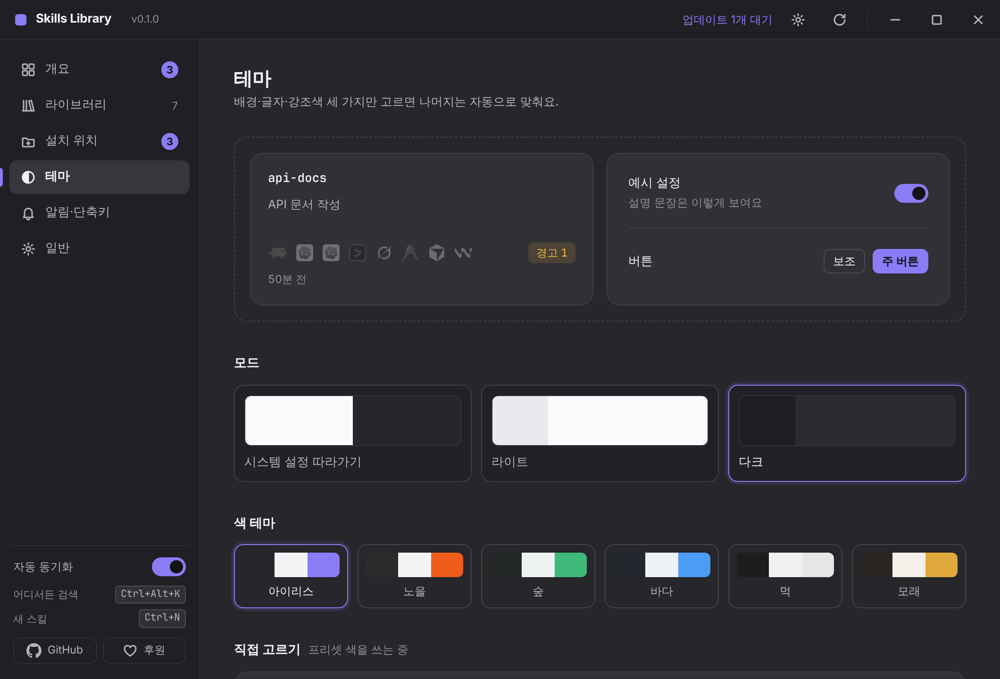

# Skills Library

[English](README.md) | **한국어** | [日本語](README.ja.md) | [简体中文](README.zh-CN.md)

Claude · Claude Code · Codex · Gemini CLI · Grok Build · Antigravity · Cursor · Windsurf **스킬을 한곳에서 관리하는 데스크톱 앱**이에요.
스킬 원본은 라이브러리에 두고, 필요한 곳에 설치하고, 고치면 설치된 곳에도 바로 반영해요.



## 내려받기

**[⬇ 최신 버전 내려받기 (Windows 설치 파일)](https://github.com/cheapbutsimilar/skills-Library/releases/latest)**

릴리스의 Assets에서 `…_x64-setup.exe` 파일을 받아 실행하세요. 한 번 설치하면 앱이 알아서 업데이트해요.

> **Windows SmartScreen 경고** — 설치 파일에 아직 유료 코드 서명 인증서가 없어서, 처음 실행할 때
> *“Windows의 PC 보호”* 창이 뜰 수 있어요. **추가 정보 → 실행**을 누르면 돼요. 설치 파일은 이 저장소의 공개
> [릴리스 워크플로](.github/workflows/release.yml)가 만들어 GitHub 릴리스에 올린 것이고, 자동 업데이트는 모두 앱의 업데이트 서명으로 검증해요.

## 무엇을 하나요

- **라이브러리** — 스킬(`SKILL.md`가 든 폴더)을 모아 두고 검색·태그·즐겨찾기로 정리해요.
- **어디든 설치** — Claude Code, Codex, Gemini CLI, Grok Build, Antigravity, Cursor, Windsurf, 프로젝트 폴더에 설치·업데이트·제거해요.
  한 곳씩 해도 되고, **켜진 에이전트 전부에 한 번에** 설치할 수도 있어요.
- **동기화** — 설치할 때 내용 해시를 기록해 두고, 라이브러리와 설치본 중 어느 쪽이 바뀌었는지 알려줘요.
  자동 동기화를 켜 두면(기본) 라이브러리에서 고친 내용이 설치된 곳에 바로 퍼져요. 설치 위치에서 따로 고친 건 건드리지 않아요.
- **고르기 전에 차이 비교** — 설치본이 *바뀜* 또는 *양쪽 다 바뀜* 상태면 **비교**를 눌러 라이브러리 원본과 설치본의 차이를
  파일·줄 단위로 보고, 같은 화면에서 가져오기나 덮어쓰기를 골라요.
- **GitHub에서 가져오기** — 저장소나 하위 폴더 주소(`https://github.com/owner/repo`, `…/tree/branch/path`)를 붙여 넣으면
  `SKILL.md`가 있는 폴더를 내려받아 검사한 뒤 라이브러리에 바로 넣어요. 폴더·ZIP·`.skill` 파일도 가져올 수 있고, 창에 끌어다 놓아도 돼요.
  처음 켜면 이미 설치된 스킬을 라이브러리로 복사해 와요(원본은 그대로).
- **편집** — 양식(name·description·본문) 또는 SKILL.md 원본으로 고치고, 스크립트·참고 문서 같은 다른 파일도 편집해요.
  저장하기 전에 규칙(이름 64자·소문자·하이픈, 설명 1024자, XML 태그 금지 …)을 실시간으로 검사해요.
- **Claude 앱** — claude.ai·Claude 데스크톱은 스킬 폴더가 없어서 ZIP으로 올려요. 버튼 한 번으로 ZIP을 만들고,
  내보낸 뒤 라이브러리가 바뀌면 다시 올리라고 알려줘요.
- **정리** — 이름이 같은데 내용이 다른 스킬은 남길 버전을 하나 골라 라이브러리와 설치된 곳 전부를 맞추고,
  예전 Codex 위치(`~/.codex/skills`)의 스킬은 현 위치(`~/.agents/skills`)로 옮겨요. 내용을 섞지 않고, 밀려난 버전은 휴지통에 백업해요.
- **안전** — 지우거나 덮어쓰는 건 모두 휴지통 폴더로 옮겨요. 실수해도 되살릴 수 있어요.
- **어디서든 검색** — <kbd>Ctrl+Alt+K</kbd>로 창을 열고 바로 검색해요. 트레이에 머물면서 새 스킬이 생기면 알려줘요.
- **한국어·영어** — 운영체제 언어를 따라가고, **일반 › 언어**에서 바꿀 수 있어요.

| 라이브러리 | 차이 비교 |
|---|---|
|  |  |
| **모든 에이전트에 설치** | **GitHub에서 가져오기** |
|  |  |
| **스킬 편집** | **테마** |
|  |  |

## 설치 위치

| 에이전트 | 사용자 전체 | 프로젝트 |
|---|---|---|
| Claude Code | `~/.claude/skills` | `<프로젝트>/.claude/skills` |
| Codex | `~/.agents/skills` | `<프로젝트>/.agents/skills` |
| Codex (예전 위치) | `$CODEX_HOME/skills` (기본 `~/.codex/skills`) — 폴더가 있으면 처음 켤 때 자동으로 켜져요 | |
| Gemini CLI | `~/.gemini/skills` — `~/.gemini`가 있으면 자동으로 켜져요 | `<프로젝트>/.gemini/skills` |
| Grok Build | `~/.grok/skills` — `~/.grok`가 있으면 자동으로 켜져요 | `<프로젝트>/.grok/skills` |
| Antigravity | `~/.gemini/antigravity/skills` — `~/.gemini/antigravity`가 있으면 자동으로 켜져요 | `<프로젝트>/.agent/skills` |
| Cursor | `~/.cursor/skills` — `~/.cursor`가 있으면 자동으로 켜져요 | `<프로젝트>/.cursor/skills` |
| Windsurf | `~/.codeium/windsurf/skills` — `~/.codeium/windsurf`가 있으면 자동으로 켜져요 | `<프로젝트>/.windsurf/skills` |
| Claude 앱 | ZIP 업로드 (설정 › 기능 › 스킬) | |

경로가 다르면 **설치 위치 › 경로 바꾸기**로 맞추면 돼요. **프로젝트 추가**로 폴더를 고르면 고른 에이전트의 위 경로가 자동으로 붙어요.

## 동기화 상태

| 상태 | 뜻 | 할 수 있는 것 |
|---|---|---|
| 최신 | 라이브러리와 같아요 | 제거 |
| 업데이트 있음 | 라이브러리가 더 새로워요 | 업데이트 (자동 동기화가 켜져 있으면 저절로) |
| 설치본이 바뀜 | 설치 위치에서 누가 고쳤어요 | 비교 · 가져오기(설치본 → 라이브러리) · 덮어쓰기 |
| 양쪽 다 바뀜 | 둘 다 고쳐졌어요 | 비교 · 가져오기 · 덮어쓰기 (어느 쪽이든 다른 쪽은 휴지통에 백업) |
| 이름 같은 다른 스킬 | 이 앱이 설치하지 않은, 이름만 같은 스킬이에요 | 비교 · 가져오기 · 덮어쓰기 |

## 개발

필요한 것: Rust(stable), Node 22, 그리고 리눅스라면 Tauri 시스템 라이브러리
(`libwebkit2gtk-4.1-dev libgtk-3-dev libayatana-appindicator3-dev librsvg2-dev libxdo-dev`).

```bash
npm install
```

```bash
npm run preview        # 브라우저 미리보기 (가짜 데이터, 자동 새로고침) → http://127.0.0.1:5199
```

```bash
npm run dev            # 실제 앱
```

```bash
npm test               # cargo test --workspace
```

```bash
npm run lint           # clippy + UI 검사 (JS 문법, 인라인 <style> 금지, 모든 t('…')에 영어 번역)
```

```bash
npm run screenshots    # docs/screenshots/*.png (영어), docs/screenshots/ko/*.png (한국어)
```

```bash
npm run demo           # docs/screenshots/demo.gif · demo-ko.gif (25fps, ffmpeg 필요)
```

```bash
npm run build          # 로컬 설치 파일
```

```bash
npm run build:win      # 리눅스에서 Windows 설치 파일 만들기 (mingw-w64, nsis 필요)
```

UI 작업은 Tauri 없이 브라우저 미리보기에서 해요. `scripts/mock-api.js`가 앱과 같은 모양의 가짜 브리지를 줘요.
미리보기 주소 뒤에 `?lang=ko`, `?mode=light`, `?preset=forest`, `?empty=1`, `?welcome=1`, `?update=1`을 붙여 여러 상태를 볼 수 있어요.

### 번역

화면 글자는 `t('한국어 원문')`으로 쓰고 영어는 [`ui/shared/i18n-en.js`](ui/shared/i18n-en.js)에 넣어요.
Rust에서 보내는 메시지는 `tr!("한국어", "English")`로 써요. 영어 번역이 빠지면 `npm run lint`가 실패해요.

## 구조

```
crates/core/        순수 로직 + 단위 테스트 (SKILL.md 파싱·검사, 라이브러리, 설치·동기화, 설정, ZIP,
                    GitHub 가져오기, 차이 비교, 다국어 메시지)
crates/devserver/   브라우저 미리보기 서버
src-tauri/src/      앱 뼈대: 명령, 트레이, 창, 단축키, 워커, 자동 업데이트, GitHub 내려받기
ui/shared/          tokens.css, theme.js, i18n.js + i18n-en.js, util.js, icons.js, logos.js, bridge.js
ui/dashboard/       대시보드 (개요 · 라이브러리 · 스킬 · 설치 위치 · 테마 · 알림·단축키 · 일반)
scripts/            mock-api.js, preview.js, demo-gif.js, check-ui.js, make-icons.py, make-logos.js
```

설정은 `%APPDATA%\com.cheapbutsimilar.skillslibrary\settings.json`(Windows) 같은 앱 데이터 폴더에,
설치 기록은 같은 폴더의 `installs.json`에 원자적으로 저장해요. 라이브러리 기본 위치도 그 아래 `library`이고,
**일반 › 라이브러리 폴더**에서 Git·클라우드 드라이브 폴더로 바꿀 수 있어요.

디자인 시스템과 데스크톱 앱 뼈대는 [docs/HANDOFF.md](docs/HANDOFF.md)를 따랐어요. 배포는 [docs/RELEASE.md](docs/RELEASE.md)를 보세요.

## 라이선스

MIT

에이전트 로고는 [LobeHub Icons](https://github.com/lobehub/lobe-icons)(MIT)의 SVG를 `scripts/make-logos.js`로 가져왔어요.
로고의 상표권은 Anthropic, OpenAI, Google, xAI, Anysphere, Cognition에 있고, 어느 에이전트인지 표시하는 용도로만 써요.

## 자매 프로젝트

**[Agent-Meter](https://github.com/cheapbutsimilar/Agent-Meter)** — AI 코딩 에이전트를 얼마나 썼고 얼마나 남았는지 보여주는 데스크톱 위젯이에요.
