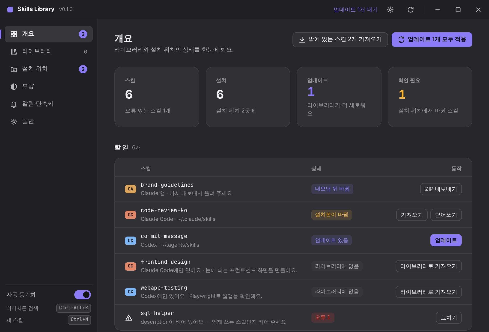
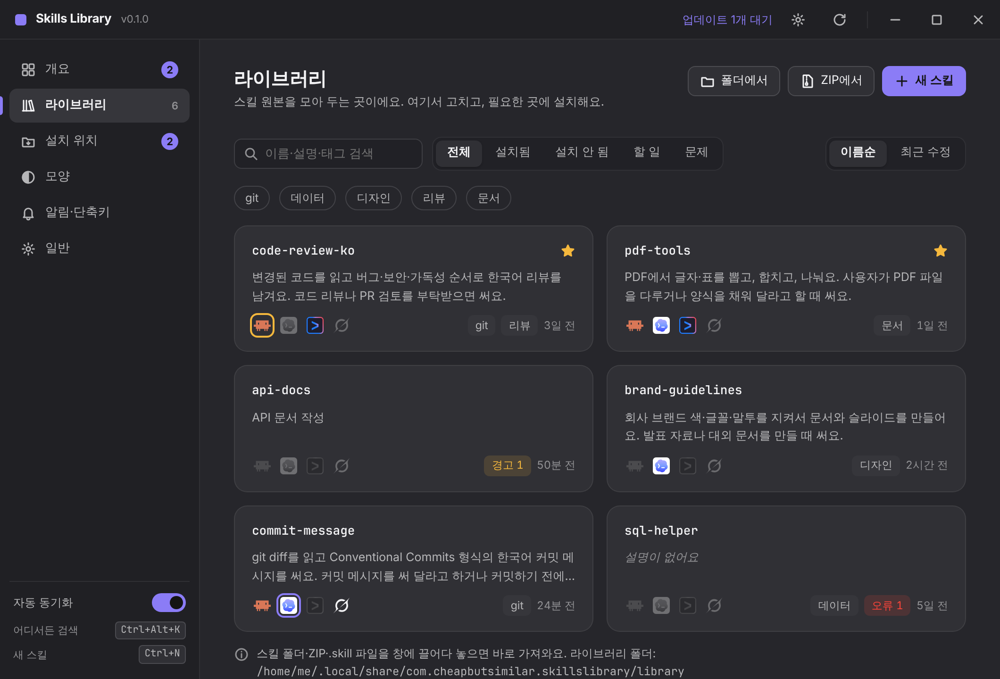
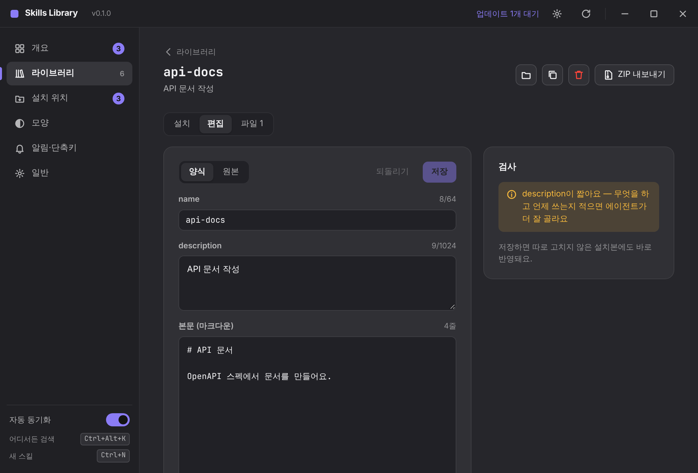
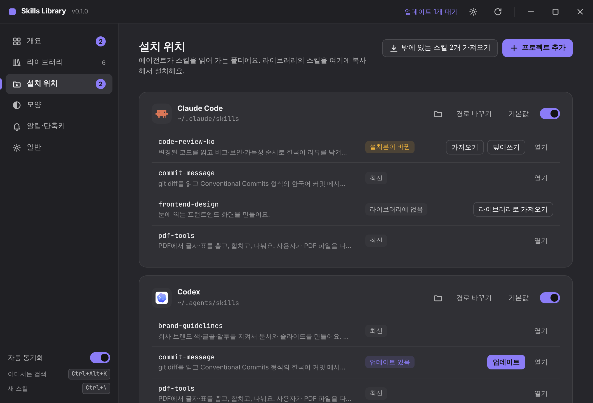
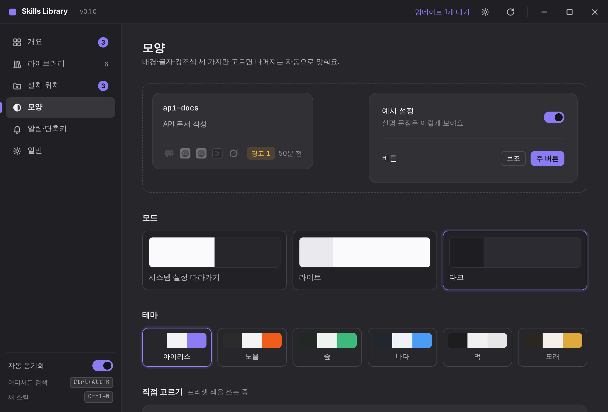

# Skills Library

Claude · Claude Code · Codex **스킬을 한곳에서 관리하는 데스크톱 앱**이에요.
스킬 원본은 라이브러리에 두고, 필요한 곳에 설치하고, 고치면 설치된 곳에도 바로 반영해요.



## 무엇을 하나요

- **라이브러리** — 스킬(`SKILL.md`가 든 폴더)을 모아 두고 검색·태그·즐겨찾기로 정리해요.
- **설치** — 라이브러리의 스킬을 Claude Code, Codex, 프로젝트 폴더에 한 번에 설치·업데이트·제거해요.
- **동기화** — 설치할 때 내용 해시를 기록해 두고, 라이브러리와 설치본 중 어느 쪽이 바뀌었는지 알려줘요.
  자동 동기화를 켜 두면(기본) 라이브러리에서 고친 내용이 설치된 곳에 바로 퍼져요. 설치 위치에서 따로 고친 건 건드리지 않아요.
- **편집** — 양식(name·description·본문) 또는 SKILL.md 원본으로 고치고, 스크립트·참고 문서 같은 다른 파일도 편집해요.
  저장하기 전에 규칙(이름 64자·소문자·하이픈, 설명 1024자, XML 태그 금지 …)을 실시간으로 검사해요.
- **Claude 앱** — claude.ai·Claude 데스크톱은 스킬 폴더가 없어서 ZIP으로 올려요. 버튼 한 번으로 ZIP을 만들고,
  내보낸 뒤 라이브러리가 바뀌면 다시 올리라고 알려줘요.
- **가져오기** — 설치 위치에만 있는 스킬, 폴더, ZIP, `.skill` 파일을 가져와요. 창에 끌어다 놓아도 돼요.
  처음 켜면 이미 설치된 스킬을 라이브러리로 복사해 와서 바로 쓸 수 있어요(원본은 그대로).
- **안전** — 지우거나 덮어쓰는 건 모두 휴지통 폴더로 옮겨요. 실수해도 되살릴 수 있어요.
- **어디서든 검색** — <kbd>Ctrl+Alt+K</kbd>로 창을 열고 바로 검색해요. 트레이에 머물면서 새 스킬이 생기면 알려줘요.

| 라이브러리 | 스킬 편집 |
|---|---|
|  |  |
| **설치 위치** | **모양** |
|  |  |

## 설치 위치

| 에이전트 | 사용자 전체 | 프로젝트 |
|---|---|---|
| Claude Code | `~/.claude/skills` | `<프로젝트>/.claude/skills` |
| Codex | `~/.agents/skills` | `<프로젝트>/.agents/skills` |
| Codex (예전 위치) | `$CODEX_HOME/skills` (기본 `~/.codex/skills`) — 폴더가 있으면 처음 켤 때 자동으로 켜져요 | |
| Claude 앱 | ZIP 업로드 (설정 › 기능 › 스킬) | |

경로가 다르면 **설치 위치 › 경로 바꾸기**로 맞추면 돼요. 프로젝트는 **프로젝트 추가**로 폴더를 고르면 위 경로가 자동으로 붙어요.

## 동기화 상태

| 상태 | 뜻 | 할 수 있는 것 |
|---|---|---|
| 최신 | 라이브러리와 같아요 | 제거 |
| 업데이트 있음 | 라이브러리가 더 새로워요 | 업데이트 (자동 동기화가 켜져 있으면 저절로) |
| 설치본이 바뀜 | 설치 위치에서 누가 고쳤어요 | 가져오기(설치본 → 라이브러리) · 덮어쓰기 |
| 양쪽 다 바뀜 | 둘 다 고쳐졌어요 | 가져오기 · 덮어쓰기 (어느 쪽이든 다른 쪽은 휴지통에 백업) |
| 이름 같은 다른 스킬 | 이 앱이 설치하지 않은, 이름만 같은 스킬이에요 | 가져오기 · 덮어쓰기 |

## 개발

필요한 것: Rust(stable), Node 22, 그리고 리눅스라면 Tauri 시스템 라이브러리
(`libwebkit2gtk-4.1-dev libgtk-3-dev libayatana-appindicator3-dev librsvg2-dev libxdo-dev`).

```bash
npm install
```

```bash
npm run preview        # 브라우저 미리보기 (가짜 데이터, 자동 새로고침) → http://127.0.0.1:5199
```

```bash
npm run dev            # 실제 앱
```

```bash
npm test               # cargo test --workspace
```

```bash
npm run lint           # clippy + UI 검사 (인라인 style 태그 금지, JS 문법)
```

```bash
npm run screenshots    # docs/screenshots/*.png
```

```bash
npm run build          # 로컬 설치 파일
```

```bash
npm run build:win      # 리눅스에서 Windows 설치 파일 만들기 (mingw-w64, nsis 필요)
```

리눅스에서 Windows용으로 만들면 `x86_64-pc-windows-gnu` 타깃을 써서 `WebView2Loader.dll`이 실행 파일 옆에 함께 설치돼요.
정식 릴리스는 Windows에서 빌드하는 릴리스 워크플로를 쓰세요.

UI 작업은 Tauri 없이 브라우저 미리보기에서 해요. `scripts/mock-api.js`가 앱과 같은 모양의 가짜 브리지를 줘요.
미리보기 주소 뒤에 `?mode=light`, `?preset=forest`, `?empty=1`, `?welcome=1`, `?update=1`을 붙여 여러 상태를 볼 수 있어요.

## 구조

```
crates/core/        순수 로직 + 단위 테스트 (SKILL.md 파싱·검사, 라이브러리, 설치·동기화, 설정, ZIP)
crates/devserver/   브라우저 미리보기 서버
src-tauri/src/
  lib.rs            앱 조립: 플러그인, 창, 트레이, 끌어다 놓기, 워커 시작
  state.rs          AppState (설정·설치 기록·스냅샷), 원자적 저장
  commands.rs       JS → Rust 명령 (창·대화상자 명령은 모두 async)
  apply.rs          설정이 바뀌면 다시 할 일 (단축키, 자동 실행, 다시 검사)
  windows.rs        대시보드 창 생성·배치 (멀티 모니터, 물리 px)
  workers.rs        폴더 변경 감지, 새 스킬 알림, 창 위치 저장, 업데이트 확인
  menu.rs, tray_icon.rs  트레이 메뉴와 직접 그린 트레이 아이콘 (할 일이 있으면 점)
  hotkeys.rs        전역 단축키 · 녹음 중 해제
  updater.rs        자동 업데이트
ui/shared/          tokens.css, theme.js(테마 엔진), util.js, icons.js, bridge.js
ui/dashboard/       대시보드 (개요 · 라이브러리 · 스킬 · 설치 위치 · 모양 · 알림·단축키 · 일반)
scripts/            mock-api.js, preview.js, check-ui.js, make-icons.py
```

설정은 `%APPDATA%\com.cheapbutsimilar.skillslibrary\settings.json`(Windows) 같은 앱 데이터 폴더에,
설치 기록은 같은 폴더의 `installs.json`에 원자적으로 저장해요. 라이브러리 기본 위치도 그 아래 `library`이고,
**일반 › 라이브러리 폴더**에서 Git·클라우드 드라이브 폴더로 바꿀 수 있어요.

디자인 시스템과 데스크톱 앱 뼈대는 [docs/HANDOFF.md](docs/HANDOFF.md)를 따랐어요. 배포는 [docs/RELEASE.md](docs/RELEASE.md)를 보세요.

## 라이선스

MIT
