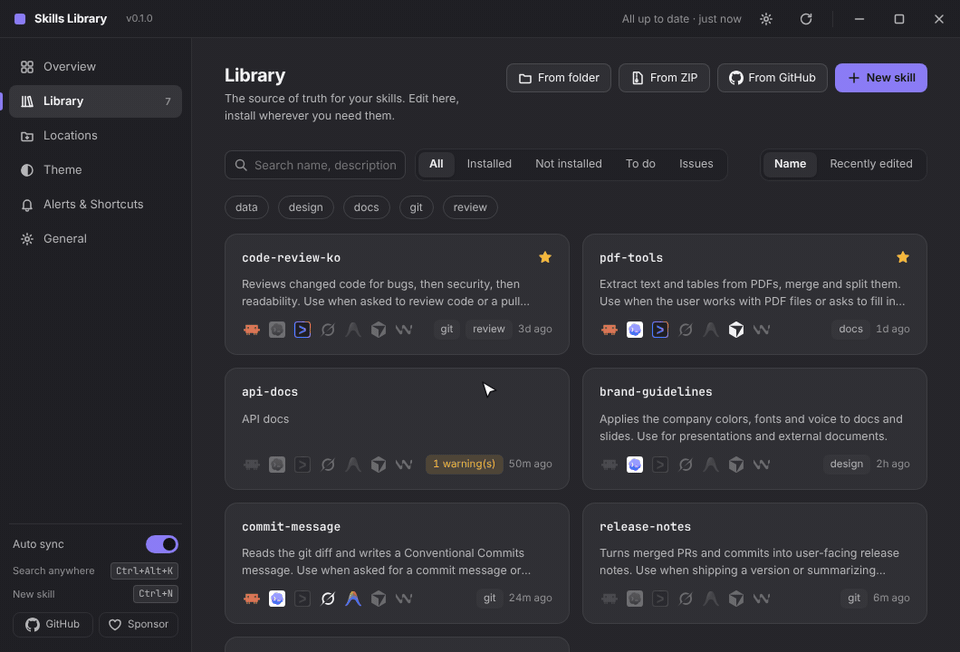
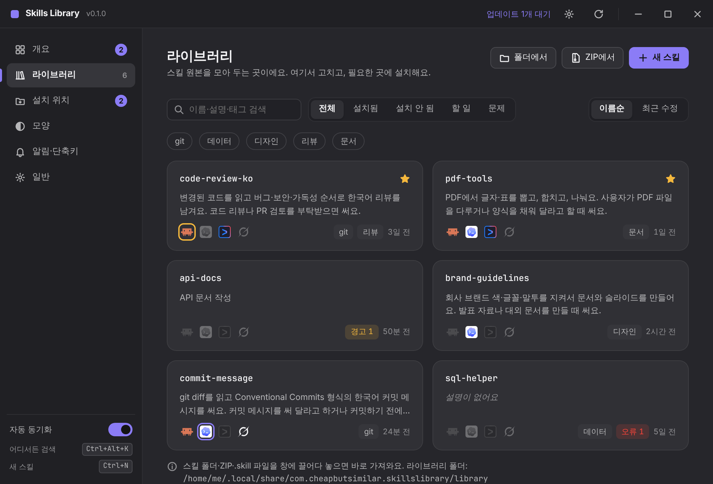
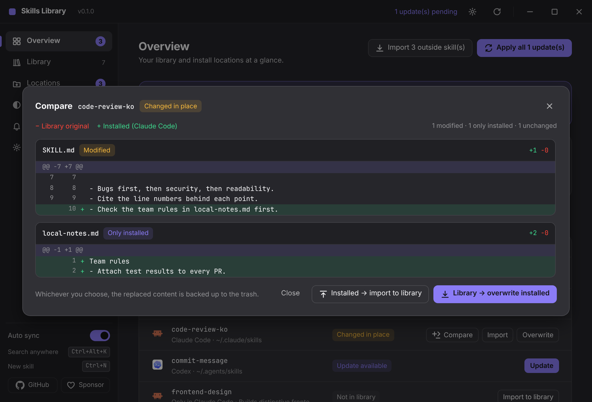
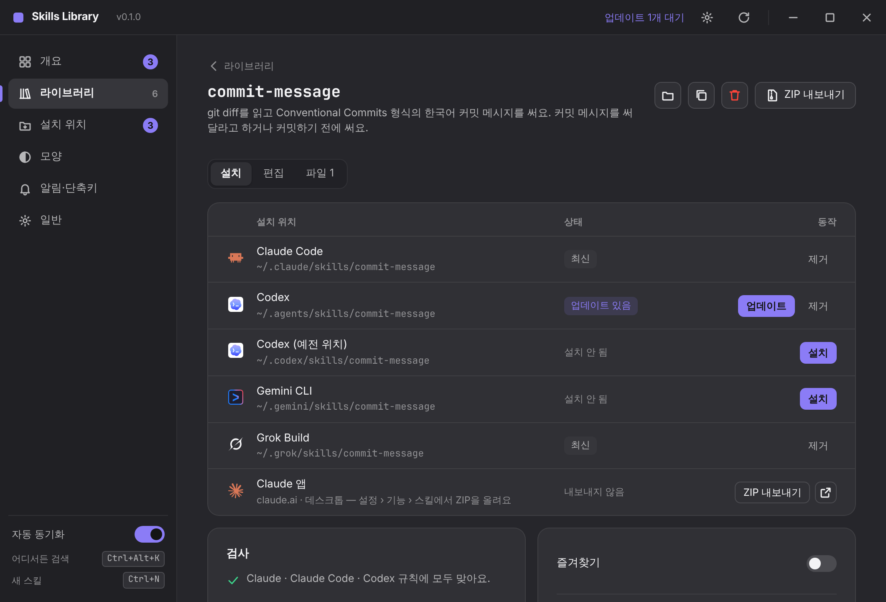
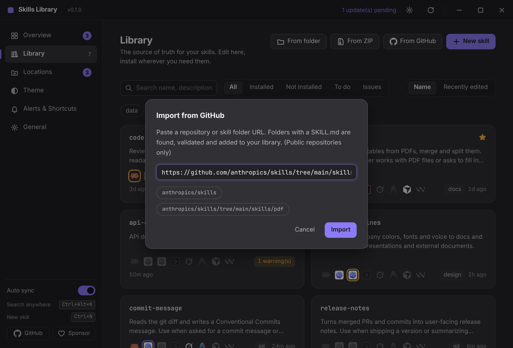
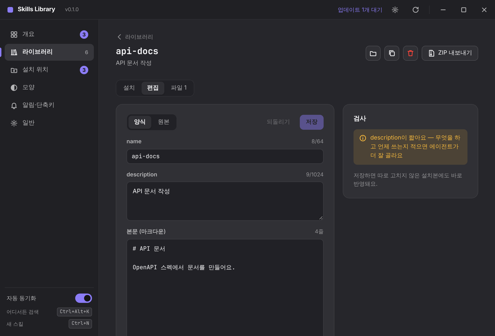

# Skills Library

[English](README.md) | [한국어](README.ko.md) | [日本語](README.ja.md) | **简体中文**

一款把 Claude、Claude Code、Codex、Gemini CLI、Grok Build、Antigravity、Cursor、Windsurf 的**智能体技能（Skills）集中管理的桌面应用**。
把技能原件放在资料库里，按需安装到各处；修改后，已安装的副本会立即同步。



## 下载

**[⬇ 下载最新版本](https://github.com/cheapbutsimilar/skills-Library/releases/latest)** — 支持 **Windows 10/11（x64）** 和 **macOS 11 Big Sur 及以上（Apple Silicon 与 Intel）**。

| 平台 | 文件 | 安装方式 |
|---|---|---|
| Windows | `…_x64-setup.exe` | 运行安装程序 |
| macOS | `…_universal.dmg` | 打开后将 **Skills Library** 拖到 **应用程序** 文件夹 |

安装后，两个平台上的应用都会自动更新。安装程序由本仓库公开的 [发布工作流](.github/workflows/release.yml) 构建，
所有自动更新都会用应用的更新签名进行校验。

> **关于 Windows SmartScreen 警告** — 安装程序暂未使用付费代码签名证书，首次运行时 Windows 可能提示
> “Windows 已保护你的电脑”。点击 **更多信息 → 仍要运行** 即可。

> **关于 macOS Gatekeeper（“无法验证开发者”）** — 应用尚未经过 Apple 公证（notarization），首次打开可能会被拦截。
> 在 **应用程序** 文件夹中 **右键（或按住 Control 点按）Skills Library → 打开**，然后在弹出的对话框中再次点击 **打开**。只需操作一次。
> 如果提示应用 “已损坏，无法打开”，请在终端中清除下载隔离属性后重新打开：
>
> ```bash
> xattr -cr "/Applications/Skills Library.app"
> ```

## 功能

- **资料库** — 收集技能（包含 `SKILL.md` 的文件夹），通过搜索、标签和收藏进行整理。
- **随处安装** — 安装、更新或移除到 Claude Code、Codex、Gemini CLI、Grok Build、Antigravity、Cursor、Windsurf 以及任意项目文件夹；
  可以逐个安装，也可以**一键安装到所有已启用的智能体**。
- **同步** — 安装时记录内容哈希，从而判断是资料库还是已安装副本发生了变化。
  开启自动同步（默认开启）后，资料库中的修改会立即同步到所有副本；在安装位置被单独修改的副本不会被覆盖。
- **先看差异再决定** — 当已安装副本处于“已在原处修改”或“双方都已修改”状态时，打开 **比较** 即可按文件、按行查看资料库原件与已安装副本的差异，
  并在同一界面选择导入或覆盖。
- **从 GitHub 导入** — 粘贴仓库或子文件夹地址（`https://github.com/owner/repo` 或 `…/tree/branch/path`），
  应用会下载其中包含 `SKILL.md` 的文件夹、进行校验并直接加入资料库。也支持文件夹、ZIP、`.skill` 文件和拖放。
- **用代码共享** — 选择部分技能或整个资料库并点击 **共享**，会得到一个像 `AB3K9MZ` 的 7 位代码和一个链接。
  在另一台电脑上把它粘贴到 **导入** 中，同样的技能就会加入那个资料库；校验与重复处理与 ZIP 导入相同。
  共享包最大 2 MB，30 天后自动过期。
- **编辑** — 可用表单（name・description・正文）或 `SKILL.md` 原文编辑，也能编辑脚本和参考文档。
  输入时实时检查规则（64 字符的小写连字符名称、1024 字符描述、禁止 XML 标签等）。
- **Claude 应用** — claude.ai 与 Claude 桌面端没有技能文件夹，需要上传 ZIP。一键生成 ZIP，资料库变化后会提醒你重新上传。
- **整理** — 对同名但内容不同的技能，选择一个版本统一到所有位置；旧版 Codex 位置（`~/.codex/skills`）中的技能会迁移到当前位置（`~/.agents/skills`）。
  不会合并内容，被替换的版本会备份到回收站。
- **安全** — 删除或覆盖的内容都会移到回收站文件夹，随时可以恢复。
- **随处搜索** — 按 <kbd>Ctrl+Alt+K</kbd>（macOS 上为 <kbd>⌥⌘K</kbd>）打开窗口并直接搜索。应用常驻托盘，发现新技能时会通知你。
- **英语与韩语界面** — 跟随系统语言，也可在 **General › Language** 中切换。

| 资料库 | 差异比较 |
|---|---|
|  |  |
| **安装到所有智能体** | **从链接或代码导入** |
|  |  |
| **编辑技能** | **主题** |
|  |  |

## 安装位置

| 智能体 | 用户级 | 项目级 |
|---|---|---|
| Claude Code | `~/.claude/skills` | `<project>/.claude/skills` |
| Codex | `~/.agents/skills` | `<project>/.agents/skills` |
| Codex（旧位置） | `$CODEX_HOME/skills`（默认 `~/.codex/skills`） | |
| Gemini CLI | `~/.gemini/skills` | `<project>/.gemini/skills` |
| Grok Build | `~/.grok/skills` | `<project>/.grok/skills` |
| Antigravity | `~/.gemini/antigravity/skills` | `<project>/.agent/skills` |
| Cursor | `~/.cursor/skills` | `<project>/.cursor/skills` |
| Windsurf | `~/.codeium/windsurf/skills` | `<project>/.windsurf/skills` |
| Claude 应用 | 上传 ZIP（设置 › 功能 › 技能） | |

首次启动时，若检测到对应智能体的配置文件夹，会自动启用该位置。路径不同时，可在应用的 **Locations › Change path** 中调整。

## 开发

需要：Rust（stable）、Node 22；Linux 上还需要 Tauri 系统库
（`libwebkit2gtk-4.1-dev libgtk-3-dev libayatana-appindicator3-dev librsvg2-dev libxdo-dev`）。

```bash
npm install
```

```bash
npm run preview        # 使用模拟数据的浏览器预览 → http://127.0.0.1:5199
```

```bash
npm run dev            # 运行真实应用
```

```bash
npm test               # cargo test --workspace
```

```bash
npm run lint           # clippy + UI 检查
```

更多结构说明与发布流程请参阅 [英文 README](README.md) 和 [docs/RELEASE.md](docs/RELEASE.md)。

## 许可证

MIT

智能体图标来自 [LobeHub Icons](https://github.com/lobehub/lobe-icons)（MIT）。商标归 Anthropic、OpenAI、Google、xAI、Anysphere、Cognition 所有，仅用于标识对应的智能体。

## 姊妹项目

**[Agent-Meter](https://github.com/cheapbutsimilar/Agent-Meter)** — 一款显示 AI 编程智能体已用量与剩余量的桌面小组件。
